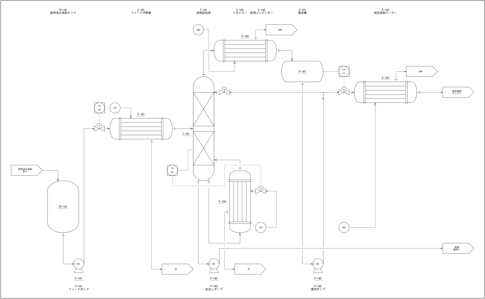
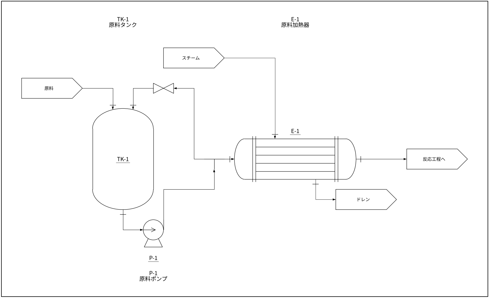
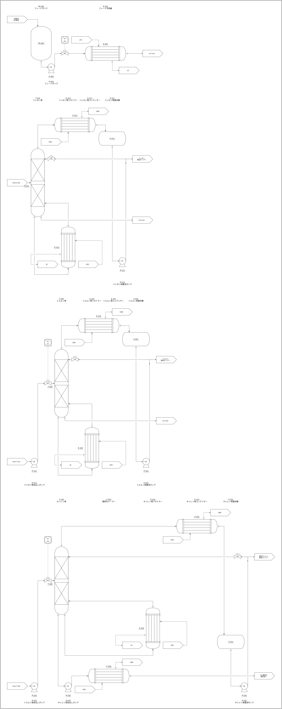

# schemdraw-pfd

**機器の種類と配管のつながりを JSON に書くだけで、PFD（プロセスフロー図）／P&ID 風の図を自動で描く**ツール。描画には [SchemDraw](https://schemdraw.readthedocs.io/) を使う（0.23 をパッケージ内に同梱。別途インストールは不要）。



*`examples/solvent_recovery.json` から自動で描いた溶剤回収設備（蒸留塔・コンデンサー・還流槽・リボイラーと3つの制御ループ）。JSON には機器の種類と配管のつながりしか書いていない（並び順・段・座標なし）*

## できること

- **自動配置**: 左右の並びは流れの向きから、高さ（段）は配管がいちばんすっきりするように決まる。並び順・座標の指定は要らない
- **自動配線**: 曲がりの少ない直交配管を探索し、交差は途切れで表す。何もないところでの U ターンは警告する
- **大きな図の折り返し**: 主流が複数の塔を通る図は、上から下へ段に折り返す（続き線のフラグを自動で付ける）
- **並列系列をそろえる**: 同じ構成の系列（並列のポンプ列、複数の塔など）は同じ形に描く
- **インライン機器と自動主管**: 弁・流量計は配管の上に書け、1つのポートに複数の配管をつなぐと主管と分岐点が自動で入る
- **改訂（フローの追加・撤去）**: 描いた図に、あとから機器・配管の追加と撤去を書き足せる。追加前の図の配置・ルート・曲がり・交差はそのままで、追加分は色（既定は赤）、撤去分は破線で示す。改訂は何回でも重ねられる
- **出力**: SVG / PNG / PDF と、Excel の図形として編集できる `.xlsx`
- **拡張**: 独自の機器（JSON か Python）、線種、図面の見た目を追加・変更できる

## インストール

Python 3.12 以上が必要。

```bash
git clone https://github.com/takuya109048/schemdraw-pfd.git
cd schemdraw-pfd
python -m venv .venv
source .venv/bin/activate      # Windows: .venv\Scripts\activate
pip install -e ".[dev]"        # 使うだけなら pip install -e .
```

以下のコマンドは、この仮想環境を有効にした状態で実行する。

### 単一ファイル版（`pfd.py`）

パッケージをインストールせずに使いたいときは、全モジュール（同梱の SchemDraw を含む）を1つのファイルにまとめた `pfd.py` を作れる。

```bash
python tools/build_single.py              # dist/pfd.py を作る（-o で出力先を変更）
```

できた `pfd.py` は、matplotlib さえ入っていればどこにでもコピーして使える（`pip install matplotlib`）。

```bash
python pfd.py SPEC.json -o out.svg        # pfd コマンドと同じオプション
```

Python から使うときは、`pfd.py` を import パスに置いて `import pfd` してから `from schemdraw_pfd import Flowsheet` とする。`pfd.py` は生成物なので直接編集せず、ソースを変えたら作り直す。

ChatGPT のカスタム GPT に `pfd.py` をアップロードして使うためのシステムプロンプトと例文は [docs/gpt/](docs/gpt/README.md) にある。

図の文字は、日本語フォントの候補（Yu Gothic, Meiryo, MS Gothic, Noto Sans CJK JP, IPAexGothic）のうち、入っている最初のものを使う。作例の画像は Noto Sans CJK JP で描いている。

## クイックスタート

### JSON から描く

`examples/feed_heating.json`（原料タンク → ポンプ → スチーム加熱器。ポンプの吐出の一部はタンクへ戻す）:

```json
{
  "elements": [
    {"id": "FEED", "type": "connector", "params": {"text": "原料"}},
    {"id": "TK-1", "type": "vertical_drum", "desc": "原料タンク"},
    {"id": "P-1", "type": "pump", "desc": "原料ポンプ"},
    {"id": "E-1", "type": "heat_exchanger", "desc": "原料加熱器"},
    {"id": "STM", "type": "connector", "params": {"text": "スチーム"}},
    {"id": "DRN", "type": "connector", "params": {"text": "ドレン"}},
    {"id": "OUT", "type": "connector", "params": {"text": "反応工程へ"}}
  ],
  "connections": [
    {"from": "FEED.tip", "to": "TK-1.n1"},
    {"from": "TK-1.bottom", "to": "P-1.in"},
    {"from": "P-1.out", "to": "E-1.tube_in"},
    {"from": "P-1.out", "to": "TK-1.n3", "recycle": true, "inline": ["valve"]},
    {"from": "E-1.tube_out", "to": "OUT.tail"},
    {"from": "STM.tip", "to": "E-1.shell_in", "type": "utility"},
    {"from": "E-1.shell_out", "to": "DRN.tail", "type": "utility"}
  ]
}
```

```bash
pfd examples/feed_heating.json -o out.png     # 拡張子で svg / png / pdf / xlsx
```



- `"recycle": true` の線はタンクへ戻る線として扱われ、並びを決めるときは無視される
- `"type": "utility"` の線（スチーム・ドレン）のフラグは、図面端ではなく加熱器のすぐ横に置かれる
- 1つのポート（`P-1.out`）に2本つなぐと、分岐点が自動で入る

### CLI

```bash
pfd SPEC.json -o out.svg        # 図を描く
pfd --list-elements             # 標準エレメントの一覧（SPEC を渡すと独自エレメントも）
pfd --describe valve            # エレメントのパラメータ・ポートの説明
```

| オプション | 内容 |
|---|---|
| `-o, --output` | 出力先（`.svg` / `.png` / `.pdf` / `.xlsx`。既定は `pfd.svg`） |
| `--layout {order,flow}` | JSON の `layout` を上書き |
| `-j, --jobs N` | 並列に使うプロセス数（既定は CPU 数。`1` で並列化しない） |
| `--fontsize` | タグ・仕様欄の文字の大きさ（ポイント。既定 20） |
| `--no-labels` / `--no-frame` | タグを描かない / 図面の枠を描かない |
| `--revision ID` | その改訂までを描く（`base` で改訂前の図）。改訂の前後を比べるときに |
| `--highlight {all,latest,none}` | 色を付ける改訂: すべて（既定）／最後の改訂だけ／なし |

### Python API

```python
from schemdraw_pfd import Flowsheet

fs = Flowsheet()  # Python では layout="order"（追加順 = 左→右の配置順）が既定
# level は省略可（ポンプは0、ほかは図が最もすっきりする段）
fs.add("pump", "P1", level=0)
fs.add("heat_exchanger", "E1", level=1)
fs.add("header", "H1", level=1, branches=3, branch_elements={1: "valve"})
fs.connect("P1.out", "E1.tube_in")  # "ID.ポート名"
fs.connect("E1.tube_out", "H1.main_w")
fs.render("out.svg")
fs.to_json("out.json")  # JSON と同じ形式で保存（from_json で読み戻せる）
```

流れから自動で並べるときは `Flowsheet(layout="flow")`。

## 機器（エレメント）

見た目は「化学工学レビュワー」の P&ID 解説記事の記載例を参考にしている（<https://chemical-engineering-review.com/piping-and-instrumentation-diagram/>）。

| type | 内容 | 主なパラメータ / ポート |
|---|---|---|
| `pump` | 円形ケーシング＋台形の台座（2x3、弁と同程度の大きさ） | `in`(水平の吸込), `out`(ケーシング右端から垂直に上へ出る吐出) |
| `valve` | `kind`: `gate` / `globe`(黒丸) / `control`(ドーム型駆動部) / `check`(Z字) | `in`, `out`, 調節弁のみ `signal` |
| `vertical_drum` / `column` | 丸鏡板の槽 / 充填層(×印)付きの塔 | `width`, `height`, `beds` / `top`, `bottom`, `n<i>`, `s<i>`（上下の鏡板のノズル。左から順、中央が `top`/`bottom`。複数のラインを別々のノズルから入れられる）, `w<i>`, `e<i>` |
| `horizontal_drum` | 横型槽 | `length`, `diameter` / `w`, `e`, `n<i>`, `s<i>` |
| `heat_exchanger` | 丸い管箱の多管式熱交換器 | `orientation`(`vertical` で縦置き) / `tube_in/out`, `shell_in/out` |
| `filter_housing` | 脚付きのカートリッジフィルターハウジング（勝和技研 SL シリーズの外形図が参考）。円筒の胴に皿形の下鏡、V バンドで留める皿形の蓋。胴の下寄りの仕切り板で、上の原液室（仕切り板の上にカートリッジが立つ。幅2セルにつき1本）と下のろ液室に分かれる | `width`(既定4), `height`(既定10、9以上。脚2・下鏡1・ろ液室2・原液室・蓋1) / `in`(西側面・仕切り板のすぐ上), `out`(東側面・ろ液室), `vent`(蓋の頂部), `drain`(下鏡の底。脚のあいだ), `w<i>`, `e<i>` |
| `instrument` | 計器。`mount`: `field`(丸=現場計器) / `dcs`(四角の中に丸) | `function`("FIC"等), `number` / `n`,`s`,`e`,`w` |
| `tee` | 配管の分岐点（計器の取り出しにも使う。黒丸なし） | `arms`("wen"等) |
| `connector` | 図面間接続の五角形フラグ | `text`, `point`(`right`/`left`) / `tip`, `tail` |
| `header` | 主管＋上向き枝管 | `branches`, `pitch`, `branch_elements` |

- 全エレメント共通: `rotation`（0/90/180/270、反時計回り）と `mirror`（左右反転。回転より先に適用）
- 大きさの目安: ポンプ 2x3 ≒ 弁 2x2 < 熱交換器 12x4 < 縦型ドラム 6x10（`width`/`height`/`length`/`diameter` で変更可）。座標・大きさはすべて整数グリッド
- 冷却塔・ストレーナー・圧縮機などの標準にない機器は、JSON の `custom_elements` で定義する（`examples/cooling_water.json` に冷却塔と Y 形ストレーナーの例）
- タグは下線付き、槽類のノズルにはフランジ線、全体に枠線（`frame=False` で無効）
- `desc`: 機器の仕様。図の上段（回転機は下段）にタグと並べて表示
- `elevation`: 段の中での高さ。省略時は、接続相手の向かい合うポートと一直線になる高さに自動でそろえる

### 接続（配管）

- 種類: `"type": "pipe"`(実線＋矢印) / `"utility"`(冷却水・スチームなど。使う機器のすぐ横にフラグを置く) / `"signal"`(破線の計装信号) / `"instrument"`(計器への細線)
- **還流・リサイクル**は `"recycle": true`。書かなくてもループは自動で見つける
- **インライン機器**: 弁や流量計は、配管の `inline` に書けば配管の上に並ぶ（配置順に並べなくてよい）

  ```python
  fs.connect(
      "P1.out",
      "C1.w8",
      inline=[
          "valve",  # id 省略: タグなし
          {"type": "valve", "id": "FV-1", "params": {"kind": "control"}},
      ],
  )
  # インライン機器の id も接続先にできる
  fs.connect("FIC-1.e", "FV-1.signal", kind="signal")
  ```

- **自動主管**: 1つのポートを複数の配管で共有すると、主管が延びて各配管が順番に切り込む（分岐点 tee は自動生成。id は `_` で始まり、タグは描かない）
- 配管の交差: 縦の配管を交点の前後で途切れさせ、奥を通っているように描く（切れ目の幅は `Theme.crossing_gap`）

## JSON 形式

```jsonc
{
  "version": 1,                       // 省略時は 1。未知のバージョンはエラー
  "layout": "flow",                   // 省略時は flow。書いた順に並べるときは "order"
  "rows": "auto",                     // flow のとき、大きな図を段に折り返す（"single" で折り返さない）
  "custom_elements": [ ... ],         // 任意。独自エレメント
  "line_kinds": { "utility": {"lw": 1.0, "ls": "-.", "arrow": "->", "process": true} },
  "elements": [ {"id": "FV-201", "type": "valve", "level": 1, "elevation": 3,
                 "desc": "...", "ports": {"x": ["N", 1]}, "params": {"kind": "control", "rotation": 90}} ],
  "connections": [ {"from": "A.out", "to": "B.in", "type": "pipe",
                    "inline": ["valve", {"type": "valve", "id": "FV-1", "params": {"kind": "control"}}],
                    "anchor": "auto"} ],
  "revisions": [ {"id": "R1", "color": "red", "note": "...", "remove": [...],
                  "elements": [...], "connections": [...]} ]   // 任意。改訂（下記）
}
```

- `elements` と `connections` の書き順は結果に影響しない（`flow` のとき）
- 未知のキー（例: `params` に入れるべき `kind` を要素の直下に書いた）はエラーになり、`elements[3] (FV-201): ...` のように場所を示す
- `_` で始まる id は自動生成用に予約されていて使えない
- `to_dict` / `to_json` は `layout` を必ず書き出す。省略した `level` は省略のまま

## 改訂（フローの追加・撤去）

描き終えた図に変更を書き足すときは、元の `elements` / `connections` はそのままにして、`revisions` に改訂を順に並べる。各改訂は**それまでの図の上に**描かれ、図を作り直さない。

```jsonc
{
  "elements": [ ... ],                     // 元の図（そのまま）
  "connections": [ ... ],
  "revisions": [
    {
      "id": "R1",                          // 必須。"base" は使えない
      "color": "red",                      // 省略時は 赤→青→緑→マゼンタ… の順
      "note": "予備ポンプ P-2 を追加",       // 凡例に出る説明（任意）
      "elements": [{"id": "P-2", "type": "pump", "desc": "予備ポンプ"}],
      "connections": [
        {"from": "TK-1.bottom", "to": "P-2.in"},   // 使用中のポートへつなぐと、既存の配管に分岐を入れる
        {"from": "P-2.out", "to": "E-1.tube_in", "inline": [{"type": "valve", "params": {"kind": "check"}}]}
      ]
    },
    {
      "id": "R2",
      "remove": [
        "FV-101",                          // 機器の id（つながる配管も消える）
        {"from": "P-1.out", "to": "TK-1.n3"}   // 配管（書いたときの from / to）
      ],
      "elements": [ ... ], "connections": [ ... ]  // 追加と撤去は同じ改訂に書ける
    }
  ]
}
```

```bash
pfd SPEC.json -o after.png                       # すべての改訂を描く（改訂ごとに色分け）
pfd SPEC.json --revision base -o before.png      # 改訂前
pfd SPEC.json --revision R1 -o r1.png            # R1 まで
pfd SPEC.json --highlight latest -o r2.png       # 最後の改訂だけ色付き（それより前は黒）
```

- **それまでの図は動かさない**: 残る機器の位置、配管のルート・曲がる位置・交差はそのまま。追加する機器は、つなぐ相手の近くの空いている場所のうち、配管が最も素直に引ける（U ターン・曲がり・交差・長さが少ない）ところに置き、配管は既存の配管を避けて引く
- **場所が足りないとき**: ある位置から先の部分をまとめて平行移動して隙間を作る。そこを横切る配管が伸びるだけなので、形（曲がり方・交差の関係）は変わらない
- **使用中のポートへの接続**: 既存の配管の途中に分岐（T 字）を入れてつなぐ。既存の配管自体は描き直さない。分岐を入れる余地がない短い配管なら、上の平行移動で伸ばしてから入れる
- **インライン機器**（弁など）は、追加の配管を引いたあと、その直線部分（つなぎ先寄り）に載せる。直線が足りなければ配管を伸ばす
- **撤去**:
  - 機器を撤去すると、つながる配管と、その配管上のインライン機器も消える。つなぐ先がなくなったフラグ、分岐が1本だけになった主管の tee も消える
  - 名前付きのインライン機器（調節弁 `FV-101` など）を撤去すると、配管は弁のあった所をまっすぐつなぎ直す（信号線は消える）
  - 配管の撤去（`{"from", "to"}`）は、ほかの配管と共有する主管を残し、その配管だけの部分を消す
- **見た目**: 追加した機器・配管・仕様欄・タグはその改訂の色、撤去したものは同じ色の破線。図の左下に凡例（`R1: 説明`）が付く。`--highlight latest` では最後の改訂だけを色付きにし、それより前の改訂は通常の線で描く（それより前に撤去したものは描かない）。`none` は色・破線・凡例なしの最終形。Excel 出力にも色・破線が付く
- 改訂は何回でも重ねられる。後の改訂は前の改訂で足した機器・配管にもつなげ、撤去もできる。前の改訂の見た目は後の改訂でも変わらない
- 折り返した図（段）で、段をまたいでしまって配管が引けないときは、両端に「to / from」のフラグの対を置く
- Python では `fs.revise("R1", color="red", note="...")` のあと、`add` / `connect` がその改訂に入る。撤去は `fs.remove("FV-101")` と `fs.disconnect("P-1.out", "TK-1.n3")`。`fs.build(until="R1")` / `fs.render(path, until="R1", highlight="latest")`

## 自動配置のしくみ（概要）

`flow` レイアウトでは、次の順で図を組み立てる。詳しい決まりは [docs/layout.md](docs/layout.md)。

1. **並び**: メインフローを左から右へ並べる（ポートの向きが優先。西向きのポートから出る線は右から左）。計器・ユーティリティのフラグはつながる機器のすぐ横、図面端のフラグは左端・右端に積む
2. **段**: `level` を書かない機器は、配管の折れ・交差・長さが最小になる段を局所探索で決める（ポンプは段0）。`level` を書けばその段に固定。省略した機器が多いほど時間がかかるので、急ぐときや結果を固定したいときは `level` を書く
3. **折り返し**: 主流が2つ以上の塔（`column` か `span` ≥ 2 の機器）を通る図は、塔ごとに段に折り返し、段をまたぐ配管は「to / from」のフラグの対にする
4. **配線**: 曲がり数を最優先に、次に距離が短い経路を A* で探す。並列系列の対応する配管は同じ形に敷く。引けない配管があれば順番を入れ替えて引き直し、だめなら隙間を広げる
5. **仕上げ**: 隙間を詰め、同じ役割のノズル・枝管の割り当てを交差が減るように入れ替え、直管の長さが足りない配管は機器をずらす

`order` レイアウト（Python API の既定）では、追加順に各機器が専用の列を持ち、左から右へ並ぶ（`set_order` で変更可）。

## 出力形式

- **SVG / PNG / PDF**: SchemDraw（matplotlib）で描く
- **Excel（`.xlsx`）**: 画像を使わず、すべて Excel の図形（直線・円弧・楕円・テキストボックス）で描く。機器・ラインごとにグループになっていて、Excel 上で1つずつ選んで編集できる。座標は元の図と同じ（A3 横・1ページ）。詳しくは [docs/xlsx.md](docs/xlsx.md)

## カスタマイズ

| 何を | どうする |
|---|---|
| 機器の向き | 全エレメント共通パラメータ `rotation`（0/90/180/270、反時計回り）と `mirror`（左右反転。回転より先に適用） |
| 独自エレメント | `fs.library.register(MySpec())`（その Flowsheet だけ）/ `register_element(...)`（全体）/ JSON の `custom_elements`（その Flowsheet だけ。他の図に漏れない） |
| 線の種類 | `fs.add_line_kind("utility", LineStyle(lw=1, ls="-.", arrow="->", process=True))`。JSON では `"line_kinds": {"utility": {"ls": "-."}}`。`process=True` の線は交差表現（途切れ）とノズルのフランジ線の対象 |
| 図面全体の見た目 | `fs.render(path, theme=Theme(fontsize=12, fonts=("Arial",), frame_lw=1, tag_underline=False))` |

## 作例

`examples/` の JSON と、それぞれの出力画像（`.png`）。どれも機器の種類と配管のつながりだけを書いていて、並び順・段（`level`）・座標は書いていない。

| ファイル | 内容 | 結果 |
|---|---|---|
| [`feed_heating`](examples/feed_heating.png) | 原料タンク → 原料ポンプ → スチーム加熱器 → 反応工程へ。ポンプの吐出の一部をタンクへ戻す（クイックスタートの例） | 機器7・交差0・警告0 |
| [`solvent_recovery`](examples/solvent_recovery.png) | 使用済み溶剤の蒸留回収。フィード予熱器・回収塔・塔頂コンデンサー・還流槽・縦置きリボイラー・回収溶剤クーラー。流量（FIC）・液面（LIC）・温度（TIC）の制御ループは、調節弁をインラインに書き、調節計から信号線でつなぐ | 機器24＋インライン調節弁4・交差9・警告0 |
| [`btx_fractionation`](examples/btx_fractionation.png) | 改質油の BTX 留分をベンゼン塔 → トルエン塔 → キシレン塔の順に精留。主流が3基の塔を通るので、予熱／各塔の4段に自動で折り返す（段をまたぐ配管は「to / from」のフラグの対） | 機器46＋インライン調節弁6・4段・交差15・警告0 |
| [`loading_station`](examples/loading_station.png) | 製品タンク3基 → 出荷ポンプ → 出荷フィルターの3系列並列のローリー出荷設備。受入・N2・出荷の3本の共通主管は自動で入る。[Excel 出力の例](examples/loading_station.xlsx)も置いている | 機器12＋インライン弁9・交差2・警告0 |
| [`cooling_water`](examples/cooling_water.png) | 冷却水の循環系統。冷却塔と Y 形ストレーナーは `custom_elements` で定義。常用・予備のポンプ2台からヘッダーで3台のクーラーへ送り、戻りは冷却塔へ合流 | 機器10＋インライン弁6・交差3・警告0 |



*`btx_fractionation.json`: 3基の塔を通る主流を4段に折り返した図*

## 開発

```bash
pytest                          # テスト（作例のレイアウトはスナップショットで回帰チェック）
ruff check . ; ruff format --check .
pyrefly check
```

- レイアウト・配線を意図的に変えたときは、スナップショットを更新する: `PFD_UPDATE_SNAPSHOTS=1 pytest tests/test_snapshots.py tests/test_cases.py`
- 作例とは別に、観点ごとの小さな例（機器2〜8個）を `tests/cases/` に置いている。全エレメント・全ポート・全パラメータ値・全 JSON キー・ポートの向きの総当たりを、どれかの例が必ず使っていることをテストで確かめる（[tests/cases/README.md](tests/cases/README.md)）
- 単一ファイル版は `tools/build_single.py` が `src/schemdraw_pfd/` から作る。ソースを圧縮して埋め込み、先頭の import フックがメモリから読み込むので、コードの書き換えはしない。SchemDraw のうち使わないサブパッケージ（logic, dsp, flow, parsing, pictorial）は省く。`tests/test_single_file.py` が、全モジュールの import と、全ケースのレイアウト・配線がパッケージ版と一致することを確かめる
- ソースの構成・設計上の決まり・配線探索の高速化と性能は [docs/internals.md](docs/internals.md)
