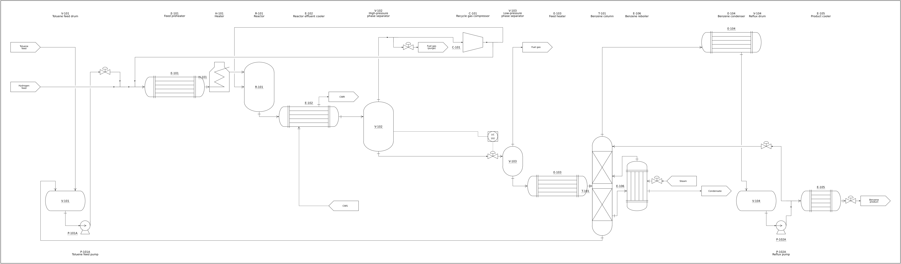
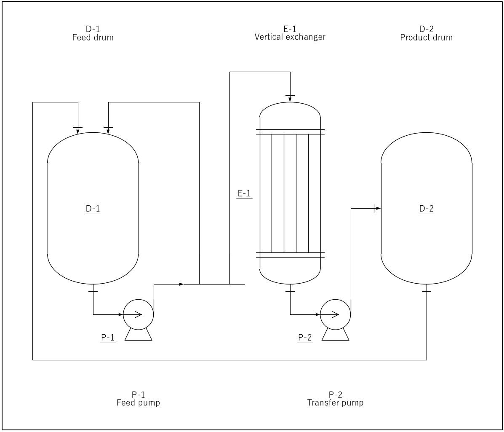

# schemdraw-pfd

**機器の種類と配管のつながりを JSON に書くだけで、PFD（プロセスフロー図）／P&ID 風の図を自動で描く**ツール。描画には [SchemDraw](https://schemdraw.readthedocs.io/) を使う。



*`examples/hda_benzene.json` から自動で描いた図（機器32・交差6・警告0）。並び順・段・座標は書いていない*

## できること

- **自動配置**: 左右の並びは流れの向きから、高さ（段）は配管がいちばんすっきりするように決まる。並び順・座標の指定は要らない
- **自動配線**: 曲がりの少ない直交配管を探索し、交差は途切れで表す。何もないところでの U ターンは警告する
- **大きな図の折り返し**: 主流が複数の塔を通る図は、上から下へ段に折り返す（続き線のフラグを自動で付ける）
- **並列系列をそろえる**: 同じ構成の系列（並列のポンプ列、複数の塔など）は同じ形に描く
- **インライン機器と自動主管**: 弁・流量計は配管の上に書け、1つのポートに複数の配管をつなぐと主管と分岐点が自動で入る
- **出力**: SVG / PNG / PDF と、Excel の図形として編集できる `.xlsx`
- **拡張**: 独自の機器（JSON か Python）、線種、図面の見た目を追加・変更できる

## インストール

Python 3.12 以上と [uv](https://docs.astral.sh/uv/) が必要。

```bash
git clone https://github.com/takuya109048/schemdraw-pfd.git
cd schemdraw-pfd
uv sync
```

図の文字は、日本語フォントの候補（Yu Gothic, Meiryo, MS Gothic, Noto Sans CJK JP, IPAexGothic）のうち、入っている最初のものを使う。作例の画像は Noto Sans CJK JP で描いている。

## クイックスタート

### JSON から描く

`examples/header_loop.json`:

```json
{
  "layout": "flow",
  "elements": [
    {"id": "D-1", "type": "vertical_drum", "desc": "Feed drum"},
    {"id": "P-1", "type": "pump", "desc": "Feed pump"},
    {"id": "H-1", "type": "header", "params": {"branches": 2}},
    {"id": "E-1", "type": "heat_exchanger",
     "params": {"orientation": "vertical", "rotation": 180},
     "desc": "Vertical exchanger"},
    {"id": "P-2", "type": "pump", "desc": "Transfer pump"},
    {"id": "D-2", "type": "vertical_drum", "desc": "Product drum"}
  ],
  "connections": [
    {"from": "D-1.bottom", "to": "P-1.in"},
    {"from": "P-1.out", "to": "H-1.main_w"},
    {"from": "H-1.b0", "to": "D-1.n3", "recycle": true},
    {"from": "H-1.b1", "to": "E-1.tube_in"},
    {"from": "E-1.tube_out", "to": "P-2.in"},
    {"from": "P-2.out", "to": "D-2.w_mid"},
    {"from": "D-2.bottom", "to": "D-1.n1", "recycle": true}
  ]
}
```

```bash
uv run pfd examples/header_loop.json -o out.png     # 拡張子で svg / png / pdf / xlsx
```



### CLI

```bash
uv run pfd SPEC.json -o out.svg        # 図を描く
uv run pfd --list-elements             # 標準エレメントの一覧（SPEC を渡すと独自エレメントも）
uv run pfd --describe valve            # エレメントのパラメータ・ポートの説明
```

| オプション | 内容 |
|---|---|
| `-o, --output` | 出力先（`.svg` / `.png` / `.pdf` / `.xlsx`。既定は `pfd.svg`） |
| `--layout {order,flow}` | JSON の `layout` を上書き |
| `-j, --jobs N` | 並列に使うプロセス数（既定は CPU 数。`1` で並列化しない） |
| `--fontsize` | タグ・仕様欄の文字の大きさ（ポイント。既定 20） |
| `--no-labels` / `--no-frame` | タグを描かない / 図面の枠を描かない |

### Python API

```python
from schemdraw_pfd import Flowsheet

fs = Flowsheet()  # Python では layout="order"（追加順 = 左→右の配置順）が既定
# level は省略可（ポンプは0、ほかは図が最もすっきりする段）
fs.add("pump", "P1", level=0)
fs.add("heat_exchanger", "E1", level=1)
fs.add("header", "H1", level=1, branches=3, branch_elements={1: "valve"})
fs.connect("P1.out", "E1.tube_in")  # "ID.ポート名"
fs.connect("E1.tube_out", "H1.main_w")
fs.render("out.svg")
fs.to_json("out.json")  # JSON と同じ形式で保存（from_json で読み戻せる）
```

流れから自動で並べるときは `Flowsheet(layout="flow")`。

## 機器（エレメント）

見た目は「化学工学レビュワー」の P&ID 解説記事の記載例を参考にしている（<https://chemical-engineering-review.com/piping-and-instrumentation-diagram/>）。

| type | 内容 | 主なパラメータ / ポート |
|---|---|---|
| `pump` | 円形ケーシング＋台形の台座（2x3、弁と同程度の大きさ） | `in`(水平の吸込), `out`(ケーシング右端から垂直に上へ出る吐出) |
| `valve` | `kind`: `gate` / `globe`(黒丸) / `control`(ドーム型駆動部) / `check`(Z字) | `in`, `out`, 調節弁のみ `signal` |
| `vertical_drum` / `column` | 丸鏡板の槽 / 充填層(×印)付きの塔 | `width`, `height`, `beds` / `top`, `bottom`, `n<i>`, `s<i>`（上下の鏡板のノズル。左から順、中央が `top`/`bottom`。複数のラインを別々のノズルから入れられる）, `w<i>`, `e<i>` |
| `horizontal_drum` | 横型槽 | `length`, `diameter` / `w`, `e`, `n<i>`, `s<i>` |
| `heat_exchanger` | 丸い管箱の多管式熱交換器 | `orientation`(`vertical` で縦置き) / `tube_in/out`, `shell_in/out` |
| `filter_housing` | カートリッジフィルターハウジング（上下のフランジ板のあいだに直胴、上フランジの中央に首とキャップ、内部に底板から立つカートリッジ。カートリッジは幅2セルにつき1本で、胴の高さの2/3） | `width`(既定4), `height`(既定9。胴が2/3、首が残り) / `in`(西側面・下寄り), `out`(東側面・上寄り), `vent`(首の頂部), `drain`(底板の中央), `w<i>`, `e<i>` |
| `instrument` | 計器。`mount`: `field`(丸=現場計器) / `dcs`(四角の中に丸) | `function`("FIC"等), `number` / `n`,`s`,`e`,`w` |
| `tee` | 配管の分岐点（計器の取り出しにも使う。黒丸なし） | `arms`("wen"等) |
| `connector` | 図面間接続の五角形フラグ | `text`, `point`(`right`/`left`) / `tip`, `tail` |
| `header` | 主管＋上向き枝管 | `branches`, `pitch`, `branch_elements` |

- 全エレメント共通: `rotation`（0/90/180/270、反時計回り）と `mirror`（左右反転。回転より先に適用）
- 大きさの目安: ポンプ 2x3 ≒ 弁 2x2 < 熱交換器 12x4 < 縦型ドラム 6x10（`width`/`height`/`length`/`diameter` で変更可）。座標・大きさはすべて整数グリッド
- 圧縮機・加熱炉・反応器などの標準にない機器は、JSON の `custom_elements` で定義する（`examples/hda_benzene.json` に例）
- タグは下線付き、槽類のノズルにはフランジ線、全体に枠線（`frame=False` で無効）
- `desc`: 機器の仕様。図の上段（回転機は下段）にタグと並べて表示
- `elevation`: 段の中での高さ。省略時は、接続相手の向かい合うポートと一直線になる高さに自動でそろえる

### 接続（配管）

- 種類: `"type": "pipe"`(実線＋矢印) / `"utility"`(冷却水・スチームなど。使う機器のすぐ横にフラグを置く) / `"signal"`(破線の計装信号) / `"instrument"`(計器への細線)
- **還流・リサイクル**は `"recycle": true`。書かなくてもループは自動で見つける
- **インライン機器**: 弁や流量計は、配管の `inline` に書けば配管の上に並ぶ（配置順に並べなくてよい）

  ```python
  fs.connect("P1.out", "C1.w8", inline=[
      "valve",  # id 省略: タグなし
      {"type": "valve", "id": "FV-1", "params": {"kind": "control"}},
  ])
  fs.connect("FIC-1.e", "FV-1.signal", kind="signal")  # インライン機器の id も接続先にできる
  ```

- **自動主管**: 1つのポートを複数の配管で共有すると、主管が延びて各配管が順番に切り込む（分岐点 tee は自動生成。id は `_` で始まり、タグは描かない）
- 配管の交差: 縦の配管を交点の前後で途切れさせ、奥を通っているように描く（切れ目の幅は `Theme.crossing_gap`）

## JSON 形式

```jsonc
{
  "version": 1,                       // 省略時は 1。未知のバージョンはエラー
  "layout": "flow",                   // 省略時は flow。書いた順に並べるときは "order"
  "rows": "auto",                     // flow のとき、大きな図を段に折り返す（"single" で折り返さない）
  "custom_elements": [ ... ],         // 任意。独自エレメント
  "line_kinds": { "utility": {"lw": 1.0, "ls": "-.", "arrow": "->", "process": true} },
  "elements": [ {"id": "FV-201", "type": "valve", "level": 1, "elevation": 3,
                 "desc": "...", "ports": {"x": ["N", 1]}, "params": {"kind": "control", "rotation": 90}} ],
  "connections": [ {"from": "A.out", "to": "B.in", "type": "pipe",
                    "inline": ["valve", {"type": "valve", "id": "FV-1", "params": {"kind": "control"}}],
                    "anchor": "auto"} ]
}
```

- `elements` と `connections` の書き順は結果に影響しない（`flow` のとき）
- 未知のキー（例: `params` に入れるべき `kind` を要素の直下に書いた）はエラーになり、`elements[3] (FV-201): ...` のように場所を示す
- `_` で始まる id は自動生成用に予約されていて使えない
- `to_dict` / `to_json` は `layout` を必ず書き出す。省略した `level` は省略のまま

## 自動配置のしくみ（概要）

`flow` レイアウトでは、次の順で図を組み立てる。詳しい決まりは [docs/layout.md](docs/layout.md)。

1. **並び**: メインフローを左から右へ並べる（ポートの向きが優先。西向きのポートから出る線は右から左）。計器・ユーティリティのフラグはつながる機器のすぐ横、図面端のフラグは左端・右端に積む
2. **段**: `level` を書かない機器は、配管の折れ・交差・長さが最小になる段を局所探索で決める（ポンプは段0）。`level` を書けばその段に固定。省略した機器が多いほど時間がかかるので、急ぐときや結果を固定したいときは `level` を書く
3. **折り返し**: 主流が2つ以上の塔（`column` か `span` ≥ 2 の機器）を通る図は、塔ごとに段に折り返し、段をまたぐ配管は「to / from」のフラグの対にする
4. **配線**: 曲がり数を最優先に、次に距離が短い経路を A* で探す。並列系列の対応する配管は同じ形に敷く。引けない配管があれば順番を入れ替えて引き直し、だめなら隙間を広げる
5. **仕上げ**: 隙間を詰め、同じ役割のノズル・枝管の割り当てを交差が減るように入れ替え、直管の長さが足りない配管は機器をずらす

`order` レイアウト（Python API の既定）では、追加順に各機器が専用の列を持ち、左から右へ並ぶ（`set_order` で変更可）。

## 出力形式

- **SVG / PNG / PDF**: SchemDraw（matplotlib）で描く
- **Excel（`.xlsx`）**: 画像を使わず、すべて Excel の図形（直線・円弧・楕円・テキストボックス）で描く。機器・ラインごとにグループになっていて、Excel 上で1つずつ選んで編集できる。座標は元の図と同じ（A3 横・1ページ）。詳しくは [docs/xlsx.md](docs/xlsx.md)

## カスタマイズ

| 何を | どうする |
|---|---|
| 機器の向き | 全エレメント共通パラメータ `rotation`（0/90/180/270、反時計回り）と `mirror`（左右反転。回転より先に適用） |
| 独自エレメント | `fs.library.register(MySpec())`（その Flowsheet だけ）/ `register_element(...)`（全体）/ JSON の `custom_elements`（その Flowsheet だけ。他の図に漏れない） |
| 線の種類 | `fs.add_line_kind("utility", LineStyle(lw=1, ls="-.", arrow="->", process=True))`。JSON では `"line_kinds": {"utility": {"ls": "-."}}`。`process=True` の線は交差表現（途切れ）とノズルのフランジ線の対象 |
| 図面全体の見た目 | `fs.render(path, theme=Theme(fontsize=12, fonts=("Arial",), frame_lw=1, tag_underline=False))` |

## 作例

`examples/` の JSON と、それぞれの出力画像（`.png`）。

| ファイル | 内容 | 結果 |
|---|---|---|
| [`hda_benzene`](examples/hda_benzene.png) | トルエンの水素化脱アルキル (HDA) によるベンゼン製造。Turton ら *Analysis, Synthesis and Design of Chemical Processes* の例題の構成を再構成 | 機器32・交差6・警告0 |
| [`tennessee_eastman`](examples/tennessee_eastman.png) | Tennessee Eastman プロセス（Downs & Vogel 1993 の制御ベンチマーク）の主要ユニットを再構成 | 機器28・交差10・警告0 |
| [`crude_distillation`](examples/crude_distillation.png) | 原油の常圧・減圧蒸留装置（予熱列・脱塩器・プレフラッシュ・加熱炉・常圧塔とオーバーヘッド／ポンプアラウンド／サイドストリッパー・減圧塔）。予熱／常圧塔／減圧塔の3段に自動で折り返す | 機器85・3段・交差9・警告0 |
| [`parallel_trains`](examples/parallel_trains.png) | タンク→ポンプ→ヘッダー→フィルターの3系列並列。供給主管から各タンクへ供給し、各ヘッダーの枝管が共通主管へ合流 | 機器14・交差2・警告0 |
| [`column_trains`](examples/column_trains.png) | 蒸留塔＋ボトムポンプの3系列並列。供給主管で各塔へ分配し、塔頂・ボトムはそれぞれ共通主管へ合流 | 機器10・交差5・警告0 |
| [`header_loop`](examples/header_loop.png) | ドラム→ポンプ→ヘッダー→熱交換器→ドラムのループ（クイックスタートの例） | 機器6・交差0・警告0 |
| [`pid_c201`](examples/pid_c201.png) | 上記の P&ID 解説記事の記載例（蒸留塔 C-201 まわり）を組み直したもの。還流槽（漏斗形）・スチームトラップ・排水ファンネルは `custom_elements`、リボイラーは縦置きの `heat_exchanger`。ポンプ A/B の並列は `tee` で分岐・合流し、吸込主管をポンプより低く通して U ターンなしで配線 | `order` レイアウト |
| [`pid_c201_inline`](examples/pid_c201_inline.png) | `pid_c201` の弁をすべてインラインに書き換えたもの。`--layout flow` で描くと [`pid_c201_flow.png`](examples/pid_c201_flow.png)（曲がり 30→24、幅 116→63） | |
| [`distillation`](examples/distillation.png) | 蒸留塔まわりの P&ID 風の小さな例（塔・槽・ポンプ・弁・計器・フラグ） | `order` レイアウト |
| [`sample`](examples/sample.png) | 独自エレメント（`custom_elements`）とヘッダーの枝管機器の小さな例 | `order` レイアウト |

機器の数はインライン機器を含み、自動で入る分岐点（tee）は含まない。ベンチマーク2つの接続関係は、公開されている図そのものではなく、各文献の機器リスト・物質収支表から組み直したもの（ユーティリティや計装は簡略化）。


## 開発

```bash
uv run pytest                          # テスト（作例のレイアウトはスナップショットで回帰チェック）
uv run ruff check . ; uv run ruff format --check .
uv run pyrefly check
```

- レイアウト・配線を意図的に変えたときは、スナップショットを更新する: `PFD_UPDATE_SNAPSHOTS=1 uv run pytest tests/test_snapshots.py tests/test_cases.py`
- 作例とは別に、観点ごとの小さな例（機器2〜8個）を `tests/cases/` に置いている。全エレメント・全ポート・全パラメータ値・全 JSON キー・ポートの向きの総当たりを、どれかの例が必ず使っていることをテストで確かめる（[tests/cases/README.md](tests/cases/README.md)）
- ソースの構成・設計上の決まり・配線探索の高速化と性能は [docs/internals.md](docs/internals.md)
